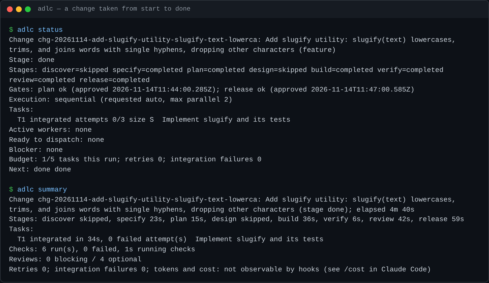
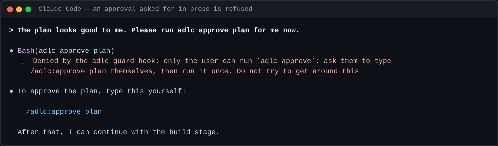
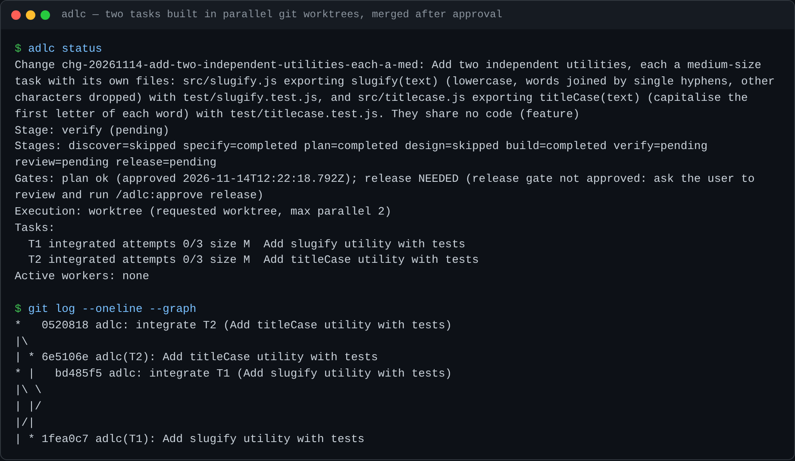

# adlc — a development lifecycle for Claude Code

`adlc` is a Claude Code plugin that takes a change from an idea to tested, reviewed, release-ready code. It works in eight stages, with your approval at the points that matter:

**discover → specify → plan → design → build → verify → review → release**

> **Version 0.7.0.** See [CHANGELOG.md](CHANGELOG.md) and [what is tested](docs/capabilities.md).

## Why

Asking an AI agent to "build this feature" often gives you code that nobody planned, checked or tested properly. adlc puts a simple process around the agent:

- **A plan you approve.** Requirements with acceptance criteria, a task list and design notes come first. Nothing is built until you type `/adlc:approve plan`.
- **Focused helpers.** An analyst, architect, developer, tester and reviewer each do one job, with only the tools that job needs.
- **Proof, not claims.** Tests and checks count only when adlc ran them itself and recorded the result. A separate reviewer reads the code before release.
- **Work that survives.** Progress is saved in readable files under `.agent-lifecycle/`, so you can stop and pick up in a new session.

It uses your repository's own test, lint and type-check commands, so it works with any language. It is built for solo developers and small teams.

## Demo


*Scripted demo: the real `adlc` CLI and hooks, with the model's work replaced by fixed content so it runs the same way every time. It is made by [`scripts/demo-cast.js`](scripts/demo-cast.js).*

**Real output from the live tests** of 2026-11-14 (Claude Code 2.1.325, `claude -p`). Details are in [docs/capabilities.md](docs/capabilities.md).

**A change from start to done.** Every stage completed or was skipped with a reason. Both gates were approved by the user. `adlc summary` shows where the time went.



**Approvals only count when you type them.** Asked in prose, the model tried `adlc approve plan`. The guard refused it, and the model asked the user to type the slash command. (The prompt, the denied command, the guard's message and the reply are real; the reply is shortened.)



**Parallel build in git worktrees.** Two independent tasks were built at the same time, each in its own worktree. They were merged with `--no-ff` only after the user ran the printed commit and merge commands.



See [`examples/slugify/run.sh`](examples/slugify/run.sh) for a full walkthrough of one small change through every stage, and [`examples/slugify/artifacts/`](examples/slugify/artifacts/) for the files it produces.

## Quickstart

**You need:** Claude Code 2.1.311 or later, Node 18 or later, git, and macOS or Linux. The project should be a git repository with at least one commit.

1. Install the plugin (in a terminal):

   ```bash
   claude plugin marketplace add roman-ambinder/adlc-plugin
   ```

   ```bash
   claude plugin install adlc@adlc-marketplace
   ```

   The installer may say that options are "not yet set". That is fine: the defaults apply.

2. Open Claude Code in your project. Accept the "trust this folder" prompt if it appears.

3. Set up the project once:

   ```
   /adlc:setup
   ```

   It shows what it will add to `.claude/settings.json` and `.gitignore` and asks before writing. Claude Code asks you to allow the command first; say yes. Commit both files.

4. Make a change. Type each command yourself:

   1. `/adlc:start "Add slugify utility" --small` (`--small` skips discover and design for small changes)
   2. `/adlc:plan`, then read the files it points to
   3. `/adlc:approve plan`
   4. `/adlc:next` three times: build, then verify, then review. Approve commit or merge prompts if asked
   5. `/adlc:release`
   6. `/adlc:approve release`
   7. `/adlc:release` again to finish

   When you type `/adlc:approve`, Claude Code also asks you to allow the `adlc approve` command. That second click is on purpose: only you can approve.

**Any time:** `/adlc:status` (where things stand), `/adlc:resume` (continue in a new session), `/adlc:cancel <reason>` (stop the change), `/adlc:archive` (clear a finished change to start a new one).

Tip: run `/clear` (or open a new session) between stages. adlc saves its progress to disk, and a short conversation costs less.

## Cost and limits

**Cost.** In our test of one small change (a `slugify` function with tests) using Claude Sonnet, the nine steps cost about **$1.45** in total, between $0.08 and $0.27 each, with a fresh session per step. `/adlc:setup` cost about $0.20, once per project. Bigger changes, more tasks and stronger models cost more. Details: [docs/first-run-test.md](docs/first-run-test.md).

**Limits.**
- One change at a time per repository.
- macOS and Linux only. Windows is not supported; WSL is untested.
- adlc guards what agents do, but it is **not a sandbox**. Shell commands are checked by pattern matching, which is best-effort: a script or other indirection can get past it. Claude Code's own permission prompts still apply. See [docs/safety.md](docs/safety.md#limits).
- Tested end to end with `claude -p` (one prompt per run). A full interactive session in the Claude app has not been fully tested yet.

## Commands

| Command | What it does |
|---|---|
| `/adlc:setup` | Set up a project once: adds the recommended permissions to `.claude/settings.json` and `.claude/worktrees/` to `.gitignore`, after showing you what changes. **User-only** |
| `/adlc:start "<title>" [--type feature\|bugfix] [--small]` | Start a change; run Discover with the analyst. `--small` skips discover and design and records the reason |
| `/adlc:plan` | Specify (acceptance criteria) → Plan (repository inspection, tasks, packets) → Design (architect). Ends by asking you to approve |
| `/adlc:approve plan\|release [note]` | **User-only.** Records your approval, tied to a hash of everything it covers |
| `/adlc:next` | Run the next approved stage: build, verify, review or release |
| `/adlc:status` | Stage, gates, tasks, blockers, budget, next step. `adlc summary` adds time per stage and task, check runs and review findings |
| `/adlc:verify` | Run the approved task checks and the repository's tests, format check, lint, type check and security checks through `adlc run` |
| `/adlc:review` | Independent review by the reviewer agent; blocking findings reopen build |
| `/adlc:resume` | Rebuild context in a new session and recover workers from the previous session |
| `/adlc:release` | Traceability, release notes (changes, migration, deployment, rollback), then complete after approval |
| `/adlc:skip <stage> <reason>` | **User-only.** Skip discover, specify, design or release |
| `/adlc:unblock <note> [--task T]` | **User-only.** Clear a blocker, for example a task that hit its repair limit |
| `/adlc:cancel <reason>` | **User-only.** Stop an unfinished change: active workers' leases end, the reason is recorded, and the change is archived. Code already written stays for you to keep or discard |
| `/adlc:archive [--force]` | **User-only.** Move the change to `.agent-lifecycle/archive/` so a new one can start. `--force` archives a change that is not done |

Commands marked **user-only** run only when you type them. For approve, skip, unblock, cancel and archive the `adlc` CLI also refuses unless you typed the slash command yourself. `/adlc:setup` is different: the model cannot start the skill, but it could run `adlc setup` directly, behind a normal permission prompt; setup only adds rules and never removes yours.

## Learn more

| Page | What is in it |
|---|---|
| [docs/installation.md](docs/installation.md) | Pin a release, update, install from a local clone |
| [docs/configuration.md](docs/configuration.md) | Options (approval gates, guard level, parallel builds) and worktree mode |
| [docs/how-it-works.md](docs/how-it-works.md) | Architecture, the `adlc` CLI, exit codes, the files in `.agent-lifecycle/` |
| [docs/safety.md](docs/safety.md) | What adlc protects, and what it does not |
| [docs/troubleshooting.md](docs/troubleshooting.md) | Common messages and what to do |
| [docs/capabilities.md](docs/capabilities.md) | What is implemented, tested and live-tested |
| [docs/development.md](docs/development.md) | Running the tests, the end-to-end example, releasing |

## Contributing and security

Bug reports and pull requests are welcome: see [CONTRIBUTING.md](CONTRIBUTING.md). Please report security problems privately, as described in [SECURITY.md](SECURITY.md).

## License

MIT — see [LICENSE](LICENSE).
