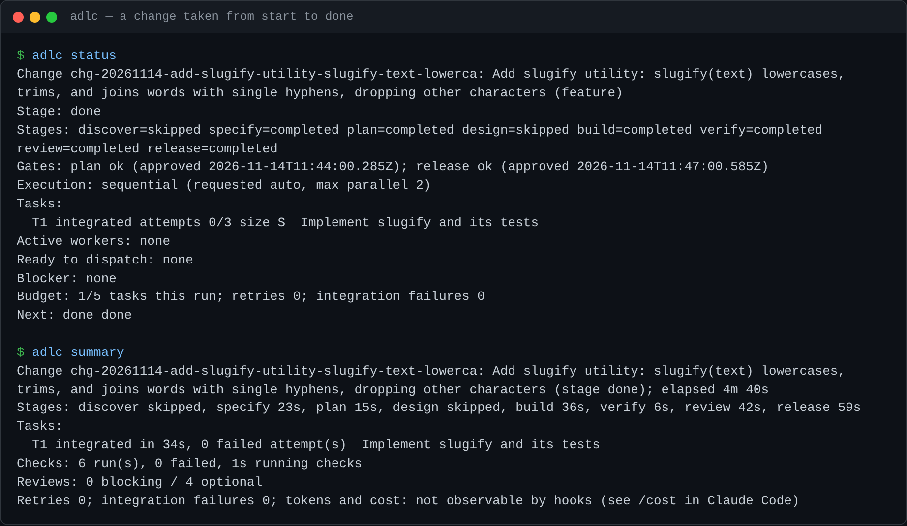
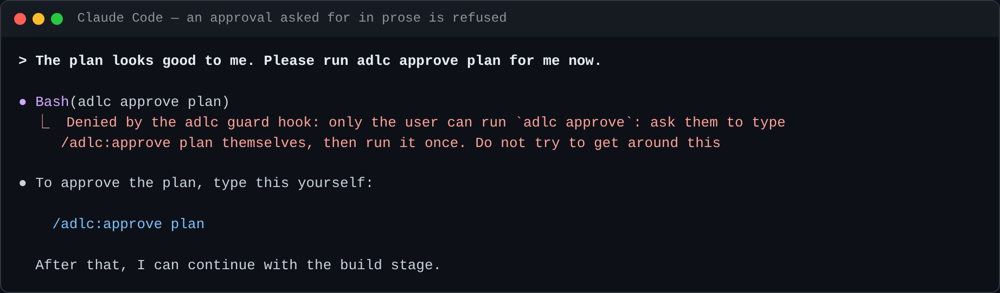
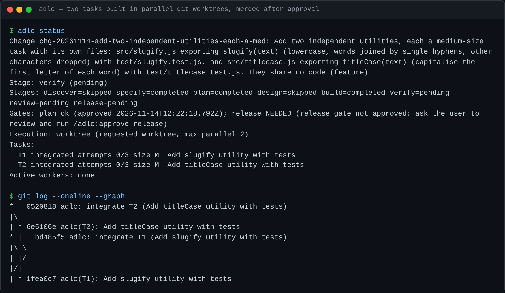

# adlc — Agentic Development Lifecycle plugin for Claude Code

`adlc` takes a change from an idea to a tested, reviewed, release-ready state. It runs eight stages:

**discover → specify → plan → design → build → verify → review → release**

Focused subagents do the work: analyst, architect, developer, tester and reviewer. State lives in readable files under `.agent-lifecycle/`, so work survives across sessions. The plugin asks for your approval at configurable gates and before risky commands.

It is built for solo developers and small teams. It is language-agnostic: it uses the repository's own test, lint, format and type-check commands.

> **Version 0.6.0.** See [CHANGELOG.md](CHANGELOG.md). Build runs sequentially, in parallel in the **shared checkout**, or in parallel in **isolated git worktrees** (one per worker), depending on the plan and the repository. The chosen mode and the reasons are recorded in `plan.md`. See [docs/capabilities.md](docs/capabilities.md).

## Quick start

**1. Install (once).** Needs Claude Code ≥ 2.1.311, Node ≥ 18 and git, on macOS or Linux.

```bash
claude plugin marketplace add roman-ambinder/adlc-plugin
```

```bash
claude plugin install adlc@adlc-marketplace
```

**2. Prepare the project (once per project).** Copy the entries from [`settings-template.json`](https://github.com/roman-ambinder/adlc-plugin/blob/main/plugins/adlc/settings-template.json) into the project's `.claude/settings.json`, so routine steps need fewer permission prompts. The project should be a git repository with at least one commit.

**3. Start Claude Code in the project.** If it asks whether you trust the folder, say yes.

```bash
cd your-project && claude
```

**4. Run a change.** Type each command yourself: approvals only count when you type them.

| Step | Type | What happens |
|---|---|---|
| 1 | `/adlc:start "Add X" --small` | Starts the change. `--small` skips discover and design; leave it out for bigger work |
| 2 | `/adlc:plan` | Writes acceptance criteria and tasks, then stops for your review |
| 3 | `/adlc:approve plan` | You approve the plan |
| 4 | `/adlc:next` | Build: workers write the code and tests. Approve the commit or merge prompts if asked |
| 5 | `/adlc:next` | Verify: runs the tests and checks |
| 6 | `/adlc:next` | Review: an independent reviewer checks the code |
| 7 | `/adlc:release` | Writes the release notes, then stops for your approval |
| 8 | `/adlc:approve release` | You approve the release |
| 9 | `/adlc:release` | Finishes the change |

**Any time:** `/adlc:status` (where things stand), `/adlc:resume` (continue in a new session), `/adlc:cancel <reason>` (stop the change), `/adlc:archive` (clear a finished change to start a new one).

Pinning a release, updating and settings are under [Installation](#installation); every command is under [Commands](#commands).

## See it work

Real output from the live tests of 2026-11-14 (Claude Code 2.1.325, `claude -p`). Details are in [docs/capabilities.md](docs/capabilities.md).

**A change from start to done.** Every stage completed or was skipped with a reason. Both gates were approved by the user. `adlc summary` shows where the time went.



**Approvals only count when you type them.** Asked in prose, the model tried `adlc approve plan`. The guard refused it, and the model asked the user to type the slash command. (The prompt, the denied command, the guard's message and the reply are real; the reply is shortened.)



**Parallel build in git worktrees.** Two independent tasks were built at the same time, each in its own worktree. They were merged with `--no-ff` only after the user ran the printed commit and merge commands.



## Architecture

```
you ──/adlc:* skills──▶ main session (coordinator rules)
                             │  Agent tool, one worker at a time
            ┌────────┬───────┼────────┬─────────┐       (shared mode: several developers at once, disjoint files)
         analyst architect developer tester  reviewer     plugin subagents with tool allowlists
                             │
                  adlc CLI (bin/adlc, Node ≥ 18, no dependencies)
                             │  locked, revision-checked, atomic writes
                    .agent-lifecycle/                     project state
hooks: SessionStart (status) · UserPromptSubmit (user intent) · PreToolUse (guard) · PostToolUse (audit) · SubagentStop (worker stopped)
```

- **Skills** are the user interface and orchestration. They call the CLI.
- **The CLI** holds every deterministic rule: stage order, gate hashes, task dependencies, leases, attempt limits, evidence. It refuses illegal transitions (exit code 2), so these rules hold however a request is phrased.
- **Hooks** enforce boundaries through Claude Code's supported controls:
  - deny edits to everything the CLI writes under `.agent-lifecycle/` (state, approvals, evidence, handoffs, packets, reviews, traceability), and commands that remove or move that directory;
  - deny edits that skip tests;
  - deny commands that mask a check's exit status (`|| true`, `; exit 0`, `set +e`), and `adlc run` refuses to record them;
  - deny reading `.env`, keys, certificates and credential files (`.npmrc`, `.netrc`, `.aws/credentials`, …) through Bash, Read or Grep, and ask before a Grep over a folder that holds such files (unless git ignores them or a glob or type filter excludes them);
  - deny writes outside a role's or task's scope;
  - ask before commits, pushes, PRs, installs, network access, destructive commands, publishing and deploying.

  Hooks never return `allow`, so platform permission prompts always apply. Guarding of Bash commands is pattern-based and best-effort: scripts or indirection can get past it. File-tool writes, role scopes and the CLI rules are enforced reliably.
- **Evidence** comes only from `adlc run`, which executes the command itself and records the exit code, duration and redacted output.

The full design is in [docs/superpowers/specs/2026-11-13-adlc-plugin-design.md](docs/superpowers/specs/2026-11-13-adlc-plugin-design.md).

### Documentation references (checked 2026-11-13, Claude Code 2.1.311)

| Topic | Page |
|---|---|
| Plugin manifest, layout, `userConfig`, `${CLAUDE_PLUGIN_ROOT}`, `bin/` | https://code.claude.com/docs/en/plugins-reference |
| Components, plugin agent frontmatter limits | https://code.claude.com/docs/en/plugins/components |
| Skills frontmatter, `$ARGUMENTS`, `disable-model-invocation` | https://code.claude.com/docs/en/skills |
| Subagents, tools, `maxTurns`, `isolation` | https://code.claude.com/docs/en/sub-agents |
| Hook events, PreToolUse decisions, SubagentStop, `agent_id` | https://code.claude.com/docs/en/hooks |
| Worktrees and `worktree.baseRef` | https://code.claude.com/docs/en/worktrees |
| Marketplace file | https://code.claude.com/docs/en/plugins/marketplace-reference |

## Directory tree

```
adlc-plugin/
├── .claude-plugin/marketplace.json      local marketplace → ./plugins/adlc
├── package.json                         npm test / npm run validate
├── README.md
├── docs/
│   ├── capabilities.md                  implemented / tested / unsupported
│   ├── images/                          README screenshots
│   └── superpowers/                     design spec and implementation plan
├── examples/slugify/
│   ├── run.sh                           end-to-end walkthrough
│   └── artifacts/                       .agent-lifecycle/ and code produced by run.sh
├── plugins/adlc/
│   ├── .claude-plugin/plugin.json       manifest + userConfig
│   ├── bin/adlc                         state CLI (on the Bash PATH while enabled)
│   ├── lib/                             cli, state, stages, tasks, packets, gates, rules,
│   │                                    evidence, redact, exec, dispatch, integrate,
│   │                                    worktree, fsutil, glob, errors, masking, userintent, schema
│   ├── hooks/                           hooks.json, guard, audit, subagent-stop,
│   │                                    session-start, prompt-submit, common, patterns
│   ├── skills/<name>/SKILL.md           start plan approve next status verify review
│   │                                    resume release skip unblock archive cancel coordinator worker-contract
│   ├── agents/                          analyst architect developer developer-worktree tester reviewer
│   ├── templates/                       requirements plan decisions handoff release review
│   ├── schemas/                         state.schema.json, handoff.schema.json (enforced by lib/schema.js)
│   └── settings-template.json           permissions to copy into .claude/settings.json
└── tests/                               node:test suites + helpers.js
```

## Installation

Requirements: Claude Code ≥ 2.1.311, Node ≥ 18, git (recommended), macOS or Linux. Windows is not supported: `adlc run` executes checks with `sh -c`, and the guard's patterns assume a POSIX shell. WSL should work but is untested.

**From GitHub (recommended):**

```bash
claude plugin marketplace add roman-ambinder/adlc-plugin
```

```bash
claude plugin install adlc@adlc-marketplace
```

Or, inside a session: `/plugin marketplace add roman-ambinder/adlc-plugin`, then `/plugin install adlc@adlc-marketplace`. Start a new session afterwards so the hooks load.

**Pin a release.** Add `#<tag>` to the source to stay on one version (see [Releases](https://github.com/roman-ambinder/adlc-plugin/releases)):

```bash
claude plugin marketplace add 'roman-ambinder/adlc-plugin#v0.6.0'
```

**Update.** Refresh the marketplace, update the plugin, then start a new session. A pinned marketplace stays on its tag; remove it and add it again with the new tag to move.

```bash
claude plugin marketplace update adlc-marketplace
```

```bash
claude plugin update adlc@adlc-marketplace
```

Read [CHANGELOG.md](CHANGELOG.md) before updating: entries under "Changed (read before upgrading)" can need action.

**Settings.** The options under [Configuration](#configuration) start unset (the defaults apply). Set them in a session with `/plugin configure adlc@adlc-marketplace`, or when installing with `--config KEY=VALUE`, for example:

```bash
claude plugin install adlc@adlc-marketplace --config guard_level=standard
```

**From a local clone (development):**

```bash
claude plugin marketplace add /path/to/adlc-plugin
```

```bash
claude plugin install adlc@adlc-marketplace
```

**For one session without installing (development):**

```bash
claude --plugin-dir /path/to/adlc-plugin/plugins/adlc
```

After changing plugin files, run `/reload-plugins` or start a new session.

**Recommended project permissions:** copy the entries from [`plugins/adlc/settings-template.json`](https://github.com/roman-ambinder/adlc-plugin/blob/main/plugins/adlc/settings-template.json) into your project's `.claude/settings.json`. A plugin cannot ship permission rules itself. The template:
- allows the routine `adlc` subcommands without a prompt;
- keeps commits, pushes, PRs, installs and publishing on `ask`;
- denies the Read tool on `.env`, keys and similar files (the guard hook also blocks them in Bash commands and Read calls).

`approve`, `skip`, `unblock`, `archive`, `cancel` and `lease` are deliberately left out of the allow list; your own slash command is what authorises the first five.

## Commands

| Command | What it does |
|---|---|
| `/adlc:start "<title>" [--type feature\|bugfix] [--small]` | Start a change; run Discover with the analyst. `--small` skips discover and design and records the reason |
| `/adlc:plan` | Specify (acceptance criteria) → Plan (repository inspection, tasks, packets) → Design (architect). Ends by asking you to approve |
| `/adlc:approve plan\|release [note]` | **User-only.** Records your approval, tied to a hash of everything it covers |
| `/adlc:next` | Run the next approved stage: build, verify, review or release |
| `/adlc:status` | Stage, gates, tasks, blockers, budget, next step. `adlc summary` adds time per stage and task, check runs and review findings |
| `/adlc:verify` | Run the approved task checks and the repository's tests, format check, lint, type check and security checks through `adlc run` |
| `/adlc:review` | Independent review by the reviewer agent; blocking findings reopen build |
| `/adlc:resume` | Rebuild context in a new session and recover workers from the previous session |
| `/adlc:release` | Traceability, release notes (changes, migration, deployment, rollback), then complete after approval |
| `/adlc:skip <stage> <reason>` | **User-only.** Skip discover, specify, design or release |
| `/adlc:unblock <note> [--task T]` | **User-only.** Clear a blocker, for example a task that hit its repair limit |
| `/adlc:cancel <reason>` | **User-only.** Stop an unfinished change: active workers' leases end, the reason is recorded, and the change is archived. Code already written stays for you to keep or discard |
| `/adlc:archive [--force]` | **User-only.** Move the change to `.agent-lifecycle/archive/` so a new one can start. `--force` archives a change that is not done |

The underlying CLI is `adlc` (on the Bash tool's PATH while the plugin is enabled). Run `adlc help` for every subcommand. Exit codes:

| Code | Meaning |
|---|---|
| 0 | ok |
| 1 | usage error |
| 2 | rule violation (illegal transition, stale gate, limit reached, readiness failure) |
| 3 | concurrent modification; re-run the command |
| 4 | no active change |
| 5 | the command `adlc run` executed failed; evidence was recorded |
| 70 | internal error |

## Configuration

Set these when enabling the plugin, or later with `/plugin` → Installed → Configure (they also appear in `/config`).

| Option | Default | Meaning |
|---|---|---|
| `approval_gates` | `plan,release` | Gates that need your approval. `none` disables them; platform prompts and guard prompts still apply. Fewer gates than the default take effect only when you type `/adlc:start` yourself |
| `guard_level` | `strict` | `standard` asks before commit, push, PR, install, network, destructive, publish and deploy commands. `strict` also asks before merge, rebase, worktree and other history edits |
| `max_repair_attempts` | `3` | Failed attempts per task before it is blocked and work stops |
| `max_tasks_per_run` | `5` | Tasks dispatched per session before the coordinator stops and writes a handoff |
| `parallel_mode` | `auto` | `auto` picks `worktree` when the repository allows it (see below), otherwise `shared`, and `sequential` when no wave has two independent M/L tasks. `worktree` and `shared` request a mode, with the same fallbacks. `sequential` always runs one worker at a time |
| `max_parallel` | `2` | Upper bound on concurrent workers in parallel modes |
| `serial_globs` | lockfiles, manifests, config, migrations, generated files | Tasks that touch these always run alone |

Values are captured into `state.json` when a change starts.

### Worktree mode

Each parallel worker runs in its own git worktree (`adlc:developer-worktree`, `isolation: worktree`). Requirements, all checked before planning and before each dispatch:

- a git repository with at least one commit;
- `"worktree": {"baseRef": "head"}` in `.claude/settings.json` (included in `settings-template.json`), so worktrees start from your current commit instead of the remote default branch;
- `.claude/worktrees/` listed in `.gitignore`;
- no uncommitted changes outside `.agent-lifecycle/`, since worktrees only see committed files.

Workers never commit. After `adlc integrate done`, the CLI prints `git worktree remove` and `git branch -d` commands for the merged worktree; the coordinator runs them after build with your approval, and git refuses to remove anything unmerged or dirty. When a task passes `adlc integrate check`, the CLI prints the exact `git add`, `git commit` (in the worktree) and `git merge --no-ff` (into your current branch) commands. The coordinator shows them and runs them only through permission prompts. Files that a check run wrote in the worktree (coverage output, lockfile rewrites) are left out of the printed `git add` and only warn. `adlc integrate done` refuses a task until its commit is merged into `HEAD` and the cross-task checks have run after the merge. Merge conflicts are aborted and reported, never resolved automatically.

## Project state: `.agent-lifecycle/`

| Path | Commit? | Written by | Contents |
|---|---|---|---|
| `state.json` | yes | CLI only | Schema 1: stages, tasks, contracts, execution plan, leases, budget, metrics, `revision` |
| `requirements.md` | yes | analyst / you | Problem, users, constraints, success criteria, `- AC-n:` lines |
| `plan.md` | yes | coordinator / you | Context, affected files, risks; CLI-owned `tasks` and `execution` sections between markers |
| `decisions.md` | yes | architect / you | Decisions `D-n`, contracts `C-n` |
| `packets/T<n>.md` | yes | CLI | Execution-ready build packet per task |
| `handoffs/T<n>.json` | yes | worker (validated by CLI) | Structured worker handoff |
| `test-results/*.md` | yes | `adlc run` only | Command, exit code, duration, redacted output (last 200 lines) |
| `reviews/*.md` | yes | CLI from the reviewer's report | Blocking and optional findings (counted by the CLI from `[B<n>]` / `[O<n>]` items) |
| `approvals.jsonl` | yes | CLI only (append) | Approvals, skips, unblocks |
| `traceability.md` | yes | `adlc trace` | AC → tasks → passing evidence |
| `handoff.md` | yes | `adlc handoff` (append) | Session notes for resuming |
| `release.md` | yes | coordinator / you | Summary, migration, deployment, rollback, known issues |
| `.lock`, `.check.lock`, `tmp/`, `runs/` | **no** | CLI / hooks | Locks, scratch files, audit log, agent bindings, write and stop logs |

`adlc start` writes `.agent-lifecycle/.gitignore` for the last row.

One change is active at a time per repository. Finish it, or archive it with `/adlc:archive`, before starting the next. `adlc` checks `state.json` against `schemas/state.schema.json` on every read, so a damaged or hand-edited file is reported with the exact fields at fault.

**Interruption safety:**
- `state.json` is written to a temp file, fsynced and renamed, under a lock. A write is refused (exit 3) if the revision changed since it was read.
- JSONL appends tolerate a torn last line.
- Markdown you edit is never regenerated; the CLI only appends, or replaces content between `<!-- adlc:begin … -->` / `<!-- adlc:end … -->` markers.

## Safety model

- **Untrusted input.** Agent prompts and coordinator rules treat repository files, tool output and subagent reports as data. The SessionStart hook injects only structured, sanitised fields.
- **Approvals.**
  - Gate approvals hash the covered artifacts, so changing scope makes an approval stale. The release approval also covers the code (a git tree id of the working tree), so a file changed after approval makes it stale; committing unchanged content does not.
  - Approve, skip and unblock skills use `disable-model-invocation: true`, so only you can start them.
  - The CLI refuses `adlc approve`, `skip`, `unblock` and `archive` unless you typed the matching slash command yourself. A `UserPromptSubmit` hook records each of your slash commands as a single-use intent that expires after 15 minutes; a command the model runs on its own, or after you only asked in prose, is refused. There is no terminal shortcut: at a terminal, type the slash command in Claude Code too. The guard denies such commands early with the same explanation. Intents live in `.agent-lifecycle/runs/`, which hooks and the guard protect.
  - An approval intent stores the gate hash from the moment you typed `/adlc:approve`. If a covered file changes before the approval is recorded, the CLI refuses and you approve again.
  - A refused action does not use up your prompt.
  - `adlc start` with fewer gates than `plan,release` needs your own `/adlc:start` (the gates come from your prompt or your plugin setting).
- **Least privilege.**
  - Each agent has a tool allowlist; the reviewer has no Write or Edit, and no adlc subagent may write files through the shell.
  - Hooks deny the analyst and architect writes outside their file.
  - A worker that has claimed a task may write only that task's files, and may not run git or state-changing `adlc` commands.
- **Honesty.**
  - Evidence comes only from executed commands.
  - Verify completes only when every task check from the approved plan has passed in that stage.
  - Review findings are counted from the reviewer's report, not reported by the coordinator.
  - A lease can be confirmed stopped only with the worker's handoff; the task budget resets only in a session the hooks recorded.
  - `integrate check` rejects claimed checks without matching evidence, and changed files outside the task.
  - Edits that add `.skip`/`.only`, and `--no-verify` or `|| true` after checks, are denied.
- **Limits.**
  - Per-task repair attempts, a per-run task budget and agent `maxTurns`.
  - Hitting a limit blocks the change and the coordinator stops.
- **Secrets.** Evidence, audit logs, review files and handoff notes pass through redaction (common token formats and `password=`/`token=` assignments). Redaction is best-effort: keep secrets out of command output.

## End-to-end example

[`examples/slugify/run.sh`](examples/slugify/run.sh) takes a small feature (a `slugify` utility) through every stage. It uses the real CLI and the real hook scripts, with model work replaced by fixed content, so the run is deterministic.

```bash
examples/slugify/run.sh
```

The resulting artifacts are committed in [`examples/slugify/artifacts/`](examples/slugify/artifacts/).

In an interactive session the same flow is the one in [Quick start](#quick-start).

## Development

```bash
npm test
```

```bash
npm run validate
```

`npm test` runs the `node:test` suites (state, stages, tasks, gates, evidence, dispatch, integration, CLI, hooks, skill and agent files, and the end-to-end example). CI (`.github/workflows/ci.yml`) runs them on Node 18, 20, 22 and 24 for pull requests and pushes to `main`, and validates the manifests with a pinned Claude Code version. `npm run validate` runs `claude plugin validate --strict` on the plugin and the marketplace.

**Releasing.** Bump `version` in `plugins/adlc/.claude-plugin/plugin.json` and `package.json`, add a `## <version> — <date>` section to `CHANGELOG.md`, and merge to `main`. `.github/workflows/release.yml` runs the tests, tags the commit `v<version>` and publishes a GitHub release with that changelog section. It does nothing if the tag already exists, and can also be started by hand (workflow_dispatch).

## Troubleshooting

| Symptom | Fix |
|---|---|
| `adlc: command not found` in Bash | The plugin must be enabled. Skills fall back to `node "${CLAUDE_PLUGIN_ROOT}/bin/adlc"`; you can run `node plugins/adlc/bin/adlc` from a checkout |
| `the user has not asked for this` | Type the slash command yourself (`/adlc:approve plan`, `/adlc:archive`, …). Scripts must submit the prompt to the `UserPromptSubmit` hook first, as `examples/slugify/run.sh` does |
| `no active change` (exit 4) | Run `/adlc:start` first. The CLI finds `.agent-lifecycle/` by walking up from the current directory, or uses `ADLC_ROOT` |
| `plan gate not approved` / `approval is stale` | Review the files, then run `/adlc:approve plan` again. Any edit to the covered files (requirements, plan, decisions) or to the tasks, contracts or execution plan after approval needs a new approval. Packets are rendered from the tasks, so they are covered through them; a hand edit to a packet is overwritten at the next dispatch |
| `state.json does not match schemas/state.schema.json` | The file was edited by hand or damaged. Restore it from version control (`git checkout -- .agent-lifecycle/state.json`) |
| `state changed concurrently` (exit 3) | Another adlc process wrote state. Re-run the command |
| `no SubagentStop record for L-…` | The worker may still be running. Once it has returned, inspect its changes and run `adlc lease stopped <L> "<note>"` |
| `approved task check … has not been run in this verify stage` | Run it with `adlc run --stage verify -- "<check>"`, using the exact text from the plan |
| `cannot count the findings` | The review report must keep the template headings, with `- [B<n>]` items or "None." under Blocking findings |
| `release approval is stale` right after approving | A project file changed after you approved. Review it and run `/adlc:approve release` again |
| Task blocked after repeated failures | Read its evidence and handoff, decide the approach, then `/adlc:unblock "<note>" --task T<n>` |
| Hooks seem inactive | Hooks act when `.agent-lifecycle/state.json` exists in the project directory or a parent of it (the same lookup as the CLI). Check `/plugin` → Errors, and `claude --debug` |
| Need to see what hooks receive | Start Claude Code with `ADLC_HOOK_LOG=/tmp/adlc-hooks.jsonl` to log hook metadata (never tool input) |
| Too many permission prompts | Copy `plugins/adlc/settings-template.json` entries into `.claude/settings.json`. Guard `ask` prompts for risky commands remain by design |

## License

MIT — see [LICENSE](LICENSE).
